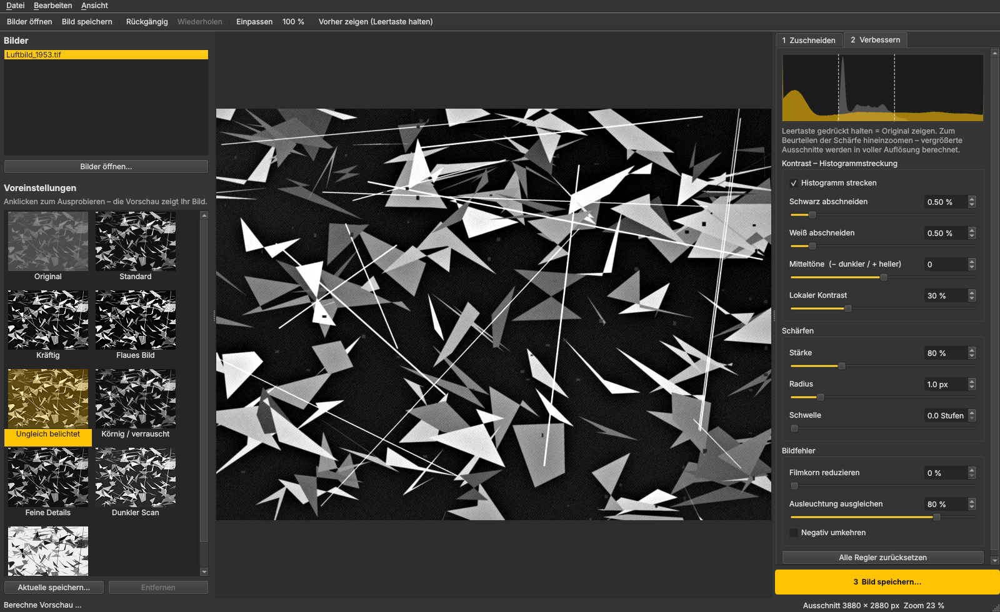

# Luftbild-Editor PZU

Ein einfaches Windows-Programm zum Bearbeiten **historischer Luftbilder** (Schwarz-Weiß / Graustufen):
pixelgenau zuschneiden, Kontrast per **Histogrammstreckung** verbessern und **schärfen**, mit
Live-Vorschau und Voreinstellungen zum schnellen Ausprobieren.



## Bedienung in drei Schritten

1. **Zuschneiden**
   - **„Ecken setzen“:** obere linke und untere rechte Ecke anklicken, eine Lupe hilft beim
     genauen Treffen.
   - **Feinjustieren:** Ecken oder Kanten ziehen, die gegenüberliegende Seite bleibt fest.
     Einen neuen Rahmen ziehst du mit gedrückter Umschalttaste auf.
   - **„Größe vom vorigen Bild übernehmen“ und „Größe festhalten“:** Alle Bilder einer Serie
     bekommen exakt dieselbe Pixelgröße (für die Photogrammetrie). Danach den Rahmen nur noch
     verschieben.
   - **Drehung** um ±10° mit Raster zum Ausrichten.
2. **Verbessern**: Links eine Voreinstellung anklicken, rechts unter *Einfach* oder *Erweitert*
   nachregeln. Die Vorschau ändert sich sofort, Leertaste gedrückt halten zeigt das Original.
3. **Bild speichern**: Das Bild wird in voller Auflösung berechnet, als TIFF 16/8 Bit, PNG oder
   JPEG. Standardmäßig mit Grauwerten **1–255** (kein Wert 0). Georeferenz und dpi bleiben
   erhalten.

## Werkzeuge

Die Bildbearbeitung folgt den Grundlagen der Bildaufbereitung historischer Luftbilder für die
Photogrammetrie: Das Histogramm wird über den ganzen Grauwertbereich gestreckt (1–255), die
Spitze abgeflacht, und es wird nur maßvoll gefiltert. Der **schwarze Scanrahmen** mit Messmarken
und Bildnummer wird automatisch erkannt und zählt bei Histogramm und Streckung nie mit.

| Bereich | Regler | Wozu |
|---|---|---|
| Kontrast | **Histogramm strecken**, Schwarz/Weiß abschneiden, Puffer | Grauwerte über den ganzen Bereich spreizen |
| | **Histogramm abflachen** mit drei Varianten | Weich (Glockenform), Stark (gleichmäßig), Schonend (Spitze kappen) |
| | **Gradationskurve** | Histogramm von Hand nachbearbeiten: Punkte setzen und ziehen |
| | Kontrastausgleich je Bildbereich, Mitteltöne, Lokaler Kontrast | Feinabstimmung |
| Schärfen | Stärke, Radius, Schwelle | Unscharf maskieren (Hochpass). Die Schwelle schont das Filmkorn |
| Filter & Bildfehler | Medianfilter 3×3/5×5, Tiefpassfilter, Staub & Kratzer, Filmkorn reduzieren, Ausleuchtung ausgleichen, Negativ umkehren | |

Das Histogramm im Programm zeigt Original und Ergebnis untereinander. Eine rote Markierung
erscheint, wenn Pixel bei 0 oder 255 anstoßen.

**Voreinstellungen** (benannt nach dem, was sie tun; Tooltip erklärt, wofür sie passen):
- **Automatisch (empfohlen):** misst jedes Bild – Streckung, bei Bedarf leichtes Abflachen
  und Medianfilter, danach Hochpassfilter.
- **Histogrammstreckung** (linear auf 1–255, wie Abb. 1 der Bachelorarbeit), allein oder
  mit **Hochpassfilter**, **Tiefpassfilter**, **Medianfilter** bzw. **Medianfilter + Hochpassfilter**.
- **Abflachen:** weich (Glockenform), stark (Ausgleich), Spitze kappen.
- **Weitere:** Lokaler Kontrastausgleich (CLAHE), Helligkeitsausgleich (Vignettierung),
  Gamma aufhellen/abdunkeln, Staub- & Kratzerfilter, Streckung mit 10 % Puffer, Negativ umkehren.

**Bedienung der Ansicht:** Strg + Mausrad zoomt zum Mauszeiger hin, das Mausrad scrollt
hoch/runter, seitliches Kippen des Rads (oder Umschalt + Rad) scrollt nach links/rechts.
Drehen ist von −180° bis +180° möglich, dazu Knöpfe für 90°-Schritte (verlustfrei).

**Georeferenzierung:** GeoTIFF-Koordinaten, Koordinatensystem sowie World-Files (.tfw/.jgw/.pgw)
und .prj bleiben beim Speichern erhalten. Zuschnitt und Drehung werden dabei korrekt
umgerechnet. Die Option *„Für GIS: Pixelwert 0 vermeiden“* speichert Schwarz als 1, damit
GIS-Programme dunkle Stellen nicht als NoData behandeln.

**Viele Bilder zuschneiden und bearbeiten (empfohlener Ablauf):**
1. Alle Bilder öffnen (auch per Drag & Drop).
2. Beim ersten Bild den Rahmen setzen und „Größe festhalten“ anhaken.
3. Zum nächsten Bild wechseln: der Rahmen erscheint dort in derselben Größe an derselben
   Stelle – nur noch hinschieben. Jedes Bild merkt sich seinen Rahmen (✂ in der Liste).
4. Voreinstellung wählen (z. B. „Automatisch“) und Stapelverarbeitung (Strg+B) starten:
   „Jedes Bild mit seinem eigenen Rahmen“ und „Regler für jedes Bild automatisch anpassen“.
   Alle Bilder werden in einem Schritt zugeschnitten, bearbeitet und gespeichert.

**Bilderliste:** mehrere Bilder mit Strg/Umschalt + Klick oder Strg+A markieren, dann
Rechtsklick → „Entfernen“ oder Entf-Taste. Rückgängig/Wiederholen mit Strg+Z und Strg+Y.

Große Scans werden für die Vorschau verkleinert berechnet. Beim Hineinzoomen und beim Speichern
rechnet das Programm in voller Auflösung, und zwar so, dass Vorschau und Ergebnis übereinstimmen.

**Fehlerprotokoll:** `%APPDATA%\Luftbild-Editor\protokoll.txt`, erreichbar über *Hilfe → Protokoll-Ordner öffnen*.

**Logo und Farben:** Das Design folgt der Website von Plan-Zentrum Umwelt (Türkis #009D88). Name und Farben stehen in `luftbild_editor/theme.py`. Das Logo wird aus der Shape-Datei `tools/logo/pzulogo.shp` gezeichnet (`python tools/render_logo.py`) und liegt als `luftbild_editor/resources/logo.png`. Daraus entsteht beim Bauen auch das Symbol der .exe.

## Installation unter Windows

**Variante A: fertige .exe.** Unter *GitHub → Actions → „Windows-Programm bauen“* das Artefakt
`Luftbild-Editor-PZU-Windows` herunterladen, entpacken und `Luftbild-Editor PZU.exe` starten. Python wird
nicht benötigt.

**Variante B: mit Python.** Python 3.10 oder neuer von python.org installieren, dann `start.bat`
doppelklicken. Beim ersten Start werden die Pakete eingerichtet.

Eine eigene .exe lässt sich mit `build_exe.bat` erzeugen.

## Entwicklung

```
pip install -r requirements.txt pytest
python -m luftbild_editor           # Programm starten
python -m pytest -q                 # Tests
```

Aufbau:

- `luftbild_editor/processing.py`: Bildverarbeitung (ohne Oberfläche, getestet)
- `luftbild_editor/widgets.py`: Bildansicht mit Zuschneiderahmen, Regler, Histogramm
- `luftbild_editor/main_window.py`: Hauptfenster
- `luftbild_editor/presets.py`: Voreinstellungen
- `luftbild_editor/batch.py`: Stapelverarbeitung
- `luftbild_editor/geo.py`: Georeferenzierung
