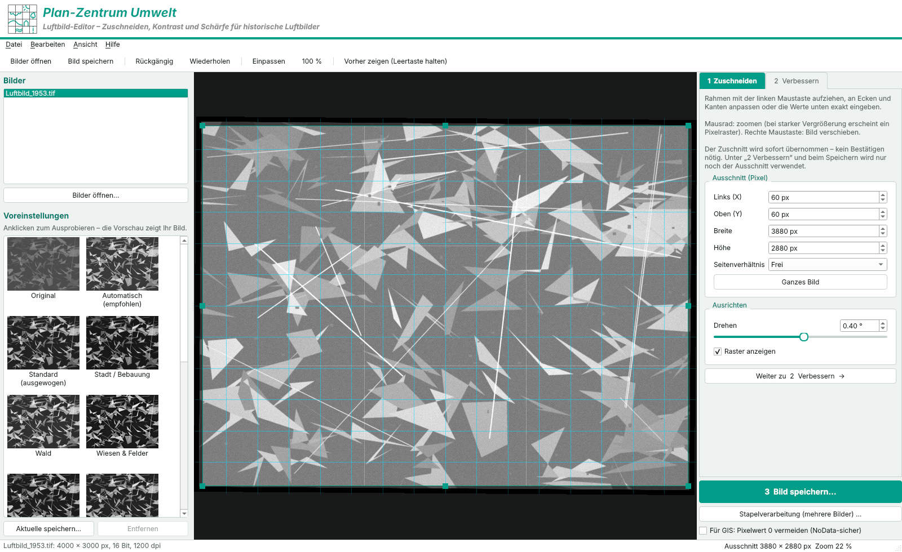
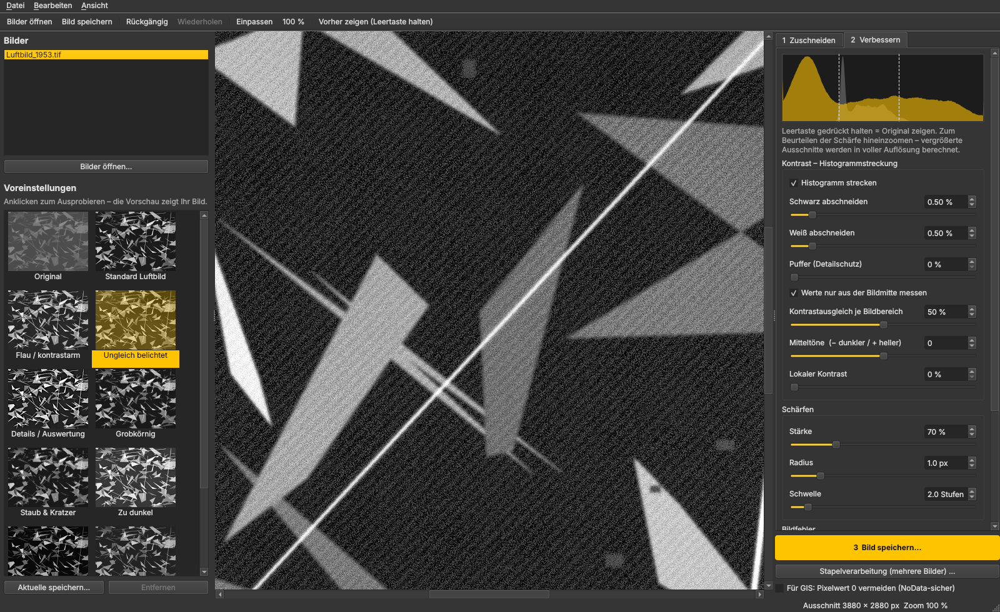

# Luftbild-Editor PZU

Ein einfaches Windows-Programm zum Bearbeiten **historischer Luftbilder** (Schwarz-Weiß / Graustufen):
pixelgenau zuschneiden, Kontrast per **Histogrammstreckung** verbessern und **schärfen**, mit
Live-Vorschau und Voreinstellungen zum schnellen Ausprobieren.


## Bedienung in drei Schritten

1. **Zuschneiden**: Rahmen mit der Maus aufziehen oder X, Y, Breite und Höhe in Pixeln eingeben.
   Beim Hineinzoomen (Mausrad) erscheint ein Pixelraster. Eine Drehung von ±10° mit Raster
   hilft, das Bild gerade auszurichten.
2. **Verbessern**: Links eine Voreinstellung anklicken. Jede Kachel zeigt das eigene Bild mit
   dieser Einstellung. Rechts lässt sich alles fein nachregeln. Die Vorschau ändert sich sofort.
   Leertaste gedrückt halten zeigt das Original.
3. **Bild speichern**: Das Bild wird in voller Auflösung berechnet, als TIFF 16/8 Bit, PNG oder
   JPEG. Bei TIFF bleibt die dpi-Angabe erhalten.

| Zuschneiden | Detailansicht 100 % |
|---|---|
|  |  |

## Werkzeuge

| Bereich | Regler | Wozu |
|---|---|---|
| Kontrast | **Histogramm strecken**, Schwarz/Weiß abschneiden | Spreizt flaue Grauwerte auf den vollen Bereich |
| | Puffer (Detailschutz) | Streckt weniger hart, damit in sehr hellen und dunklen Bereichen nichts verloren geht |
| | Bildrand nicht mitmessen | Scanrahmen, Messmarken und Beschriftung verfälschen die Streckung nicht |
| | **Kontrastausgleich je Bildbereich** | CLAHE bzw. „Multidodging“: holt Details aus flauen und dunklen Partien |
| | Mitteltöne, Lokaler Kontrast | Feinabstimmung |
| Schärfen | Stärke, Radius, Schwelle | Unscharf maskieren. Die Schwelle verhindert, dass Filmkorn mitgeschärft wird |
| Bildfehler | Staub & Kratzer entfernen | Entfernt kleine Punkte und feine Kratzer vom Scan |
| | Filmkorn reduzieren | Kantenerhaltendes Glätten |
| | Ausleuchtung ausgleichen | Gleicht dunkle Ränder und Vignettierung aus |
| | Negativ umkehren | Für gescannte Negative |

**Voreinstellungen:**
- **Automatisch (empfohlen):** misst Helligkeit, Kontrast und Filmkorn jedes Bildes und stellt
  die Regler passend ein, egal ob Stadt, Wald, Wiesen oder Wasser. Das funktioniert auch in der
  Stapelverarbeitung je Bild.
- **Nach Bildinhalt:** Stadt/Bebauung, Wald, Wiesen & Felder, Wasser/Fluss.
- **Nach Bildproblem:** Flau/kontrastarm, Details/Auswertung (Bombentrichter, Gräben), Zu dunkel,
  Zu hell, Ungleich belichtet, Grobkörnig, Staub & Kratzer.
- **Sonstige:** Standard, GIS/DGM sicher (wie das Gemini-Skript), Negativ.

Abgestimmt wurden sie an echten Weltkriegs-Luftbildern: Helle Flächen und dunkle Partien behalten
Zeichnung, weil Lichter und Schatten weich begrenzt statt hart abgeschnitten werden.

**Georeferenzierung:** GeoTIFF-Koordinaten, Koordinatensystem sowie World-Files (.tfw/.jgw/.pgw)
und .prj bleiben beim Speichern erhalten. Zuschnitt und Drehung werden dabei korrekt
umgerechnet. Die Option *„Für GIS: Pixelwert 0 vermeiden“* speichert Schwarz als 1, damit
GIS-Programme dunkle Stellen nicht als NoData behandeln.

**Stapelverarbeitung:** Mit dem Knopf unter „Bild speichern“ oder Strg+B werden die
Einstellungen des aktuellen Bildes auf weitere Bilder oder ganze Ordner angewendet. Auf Wunsch
werden Zuschnitt und Drehung mit übernommen.

Weitere Funktionen: mehrere Bilder öffnen (auch per Drag & Drop) sowie Rückgängig/Wiederholen
mit Strg+Z und Strg+Y.

Große Scans werden für die Vorschau verkleinert berechnet. Beim Hineinzoomen und beim Speichern
rechnet das Programm in voller Auflösung, und zwar so, dass Vorschau und Ergebnis übereinstimmen.

**Fehlerprotokoll:** `%APPDATA%\Luftbild-Editor\protokoll.txt`, erreichbar über *Hilfe → Protokoll-Ordner öffnen*.

**Logo und Farben:** Das Design folgt der Website von Plan-Zentrum Umwelt (Türkis #009D88). Name und Farben stehen in `luftbild_editor/theme.py`. Das Logo wird aus der Shape-Datei `tools/logo/pzulogo.shp` gezeichnet (`python tools/render_logo.py`) und liegt als `luftbild_editor/resources/logo.png`. Daraus entsteht beim Bauen auch das Symbol der .exe.

## Installation unter Windows

**Variante A: fertige .exe.** Unter *GitHub → Actions → „Windows-Programm bauen“* das Artefakt
`Luftbild-Editor-PZU-Windows` herunterladen, entpacken und `Luftbild-Editor PZU.exe` starten. Python wird
nicht benötigt.

**Variante B: mit Python.** Python 3.10 oder neuer von python.org installieren, dann `start.bat`
doppelklicken. Beim ersten Start werden die Pakete eingerichtet.

Eine eigene .exe lässt sich mit `build_exe.bat` erzeugen.

## Entwicklung

```
pip install -r requirements.txt pytest
python -m luftbild_editor           # Programm starten
python -m pytest -q                 # Tests
```

Aufbau:

- `luftbild_editor/processing.py`: Bildverarbeitung (ohne Oberfläche, getestet)
- `luftbild_editor/widgets.py`: Bildansicht mit Zuschneiderahmen, Regler, Histogramm
- `luftbild_editor/main_window.py`: Hauptfenster
- `luftbild_editor/presets.py`: Voreinstellungen
- `luftbild_editor/batch.py`: Stapelverarbeitung
- `luftbild_editor/geo.py`: Georeferenzierung
